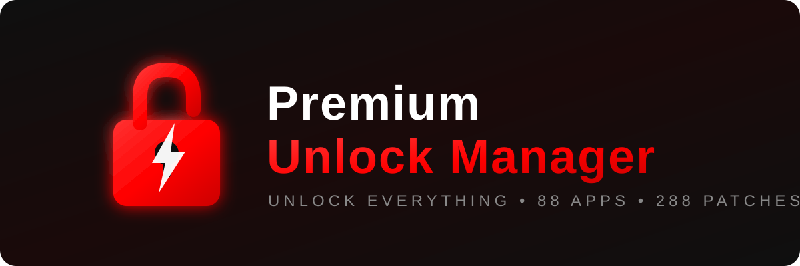
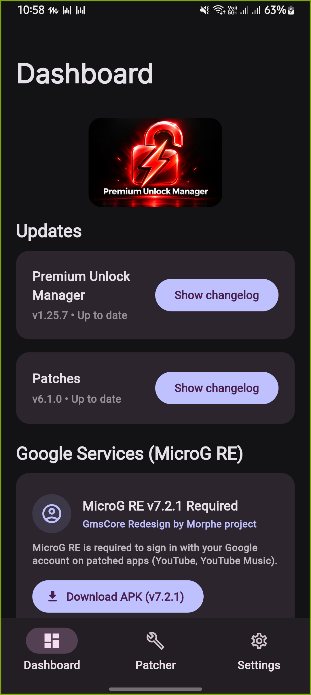
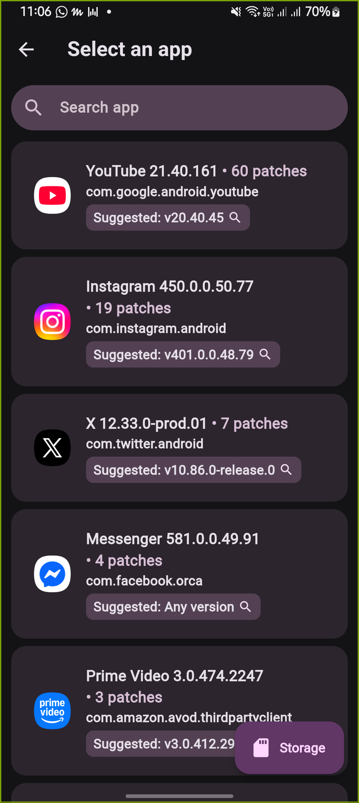
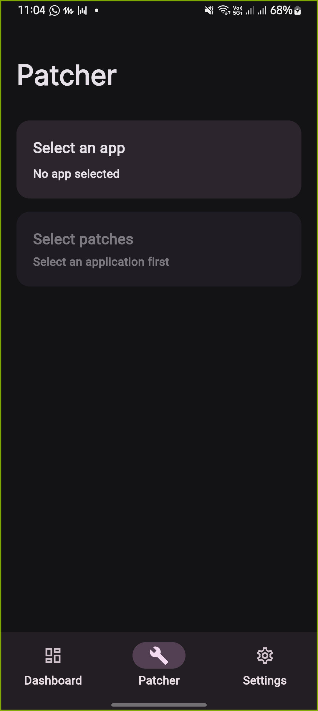
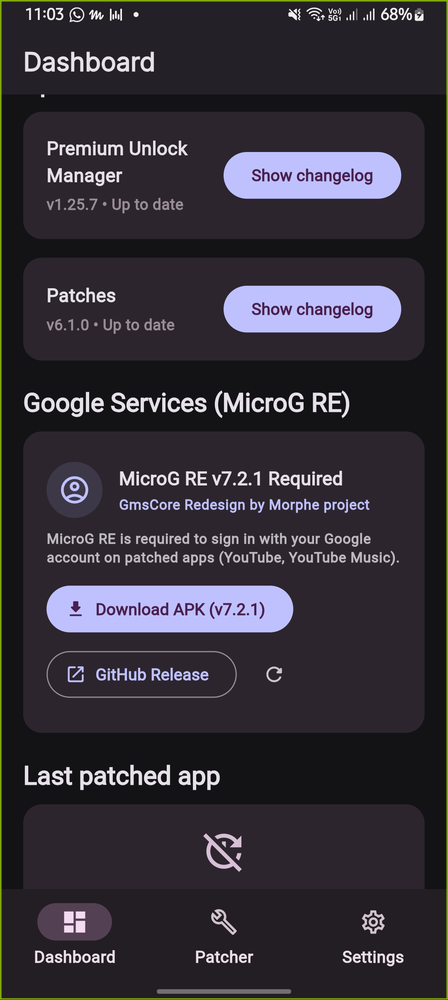
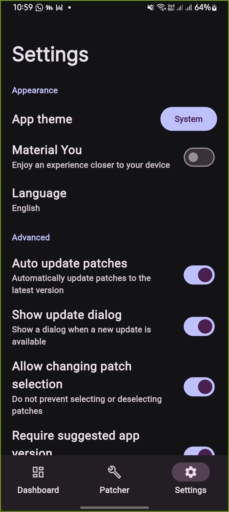

# 🔓 Premium Unlock Manager

### *Unlock premium features in your favourite Android apps — beautifully.*

**88 apps • 288 patches • 4 patch sources • MicroG RE ready**

---

## ✨ Why Premium Unlock Manager?

<table>
<tr>
<td width="50%">

### 🎯 One Manager, Everything
Patch YouTube, Spotify, Instagram, X/Twitter, Reddit, TikTok, Twitch, Messenger and **80+ more apps** — all from a single, gorgeous dashboard.

### ⚡ Asset-First Architecture
Patches load **instantly** from bundled assets. No GitHub API dependency — fully **DMCA 451-proof**. Works even when GitHub is blocked in your region.

</td>
<td width="50%">

### 🔴 Signature Red Identity
A bold unlocked-padlock + lightning monogram in YouTube-red. Instantly recognisable. Unmistakably premium.

### 🧩 4 Patch Sources
ReVanced Official, **anddea (RVX)**, **Morphe**, and **Piko/crimera** — switch sources per-app from Settings → Alternative sources.

</td>
</tr>
</table>

---

## 📊 At a Glance

| | |
|---|---|
| 📱 **Supported Apps** | **88** unique apps |
| 🧩 **Total Patches** | **288** bundled patches |
| 🌐 **Patch Sources** | **4** — ReVanced Official (default), anddea RVX, Morphe, Piko |
| 🔧 **MicroG** | **MicroG RE v7.2.1** — dedicated dashboard card, install detection, one-tap APK download |
| 🎨 **App List UI** | RVX Manager-style rows: icon, name, version, patch count, suggested-version badge, live search |
| 🛡️ **DMCA Resilient** | Asset-first loading — zero GitHub API calls for default patches |
| 📦 **Package** | `app.unlockmanager.manager.flutter` |
| 🏷️ **Version** | `1.25.7` (versionCode `102500700`) |

---

## 🚀 Popular Apps You Can Patch

| App | Patches | App | Patches |
|---|---|---|---|
| ▶️ YouTube | 60 | 🎵 YouTube Music | 19 |
| 📸 Instagram | — | 🎵 Spotify | 5 |
| 𝕏 X / Twitter | 7 | 🤖 Reddit + clients | 30+ |
| 🎵 TikTok / Asia | 10 | 🎮 Twitch | — |
| 💬 Messenger | 4 | 📷 Google Photos | — |
| 🏃 Strava | 8 | ☁️ SoundCloud | 3 |
| 📘 Facebook | 2 | 📋 [**Full list →**](COMPLETE_APP_FEATURES.md) | **77 apps** |

> 📖 **Every app + what gets unlocked:** see [**COMPLETE_APP_FEATURES.md**](COMPLETE_APP_FEATURES.md) — the complete catalog with per-app unlocked features.

---

## 📲 Installation

### Requirements
- Android 8.0 (API 26) or higher
- ~150 MB free storage

### Steps

1. **Download** the latest APK from [Releases](https://github.com/PsProsen-Dev/premium-unlocker-manager/releases)
2. **Allow** "Install unknown apps" when prompted
3. **Install** the APK
4. **(For YouTube / YouTube Music)** Install **MicroG RE v7.2.1** — the app shows a one-tap download card on the dashboard if it's missing

> 💡 **Tip:** After patching YouTube or YouTube Music, the app will alert you if MicroG RE isn't installed, so Google login keeps working.

---

## 🖼️ Screenshots

> Real screenshots captured on Samsung Galaxy A23 (SM-A236E), v1.25.7

| Dashboard | Select an App | Patcher |
|---|---|---|
|  |  |  |

| MicroG RE | Settings |
|---|---|
|  |  |

---

## 🛠️ Tech Stack

- **Flutter** 3.47.7 (Dart 3.13.5) — cross-platform UI
- **Material 3** — modern Android design language
- **Method Channels** — native patcher engine bridge (Kotlin)
- **Bundled patch assets** — `assets/patches/default_patches.json`
- **MicroG RE** integration — `app.revanced.android.gms`

---

## 🗺️ Roadmap

- [x] Core patcher engine + 88-app catalog
- [x] 4 patch sources with per-app selection
- [x] MicroG RE v7.2.1 dashboard integration
- [x] Asset-first patch loading (DMCA-proof)
- [x] Signature red brand identity
- [ ] In-app update checker
- [ ] Patch favourites & history
- [ ] Dark/light theme toggle

---

## 🤝 Contributing

Contributions are welcome! Here's how:

1. **Fork** the repository
2. Create a feature branch — `git checkout -b feature/amazing-feature`
3. **Commit** your changes — `git commit -m "Add amazing feature"`
4. **Push** — `git push origin feature/amazing-feature`
5. Open a **Pull Request**

Please keep the red brand identity intact in any UI contributions. 🔴

---

## 📄 License

This project is licensed under the **MIT License** — see the [LICENSE](LICENSE) file for details.

---

### 🔓 Premium Unlock Manager

*Unlock everything.*

Built with ❤️ and Flutter · © 2026 We Digital Mitra

